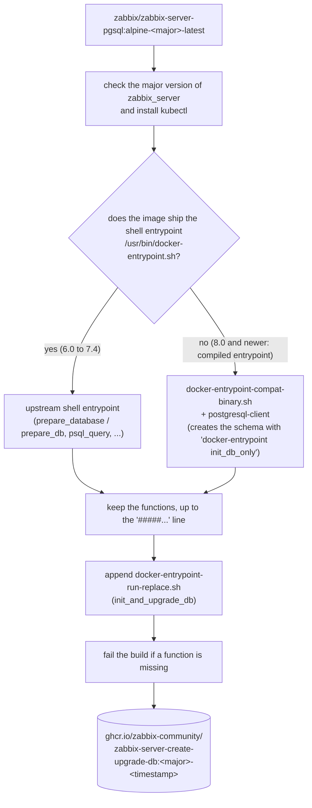
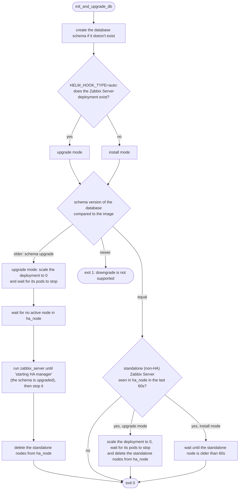
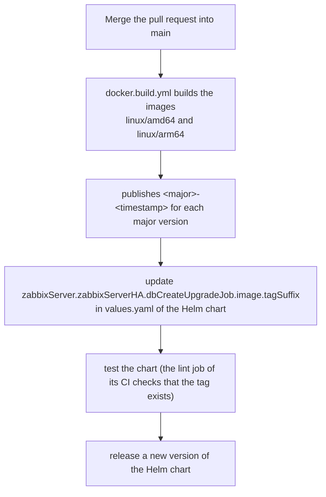

# Zabbix Server database initialization and upgrade job

[](https://opensource.org/licenses/Apache-2.0)

<!-- TOC -->

- [Zabbix Server database initialization and upgrade job](#zabbix-server-database-initialization-and-upgrade-job)
  - [About](#about)
  - [How it works](#how-it-works)
    - [Image build](#image-build)
    - [Decision flow of the job](#decision-flow-of-the-job)
  - [Image tags](#image-tags)
  - [Environment variables](#environment-variables)
  - [Kubernetes permissions](#kubernetes-permissions)
  - [Development and local tests](#development-and-local-tests)
  - [Repository structure](#repository-structure)
  - [Release process](#release-process)
  - [Contributing](#contributing)
  - [Maintainers](#maintainers)
  - [License](#license)

<!-- TOC -->

## About

This repository builds the image ``ghcr.io/zabbix-community/zabbix-server-create-upgrade-db``, used by the [Zabbix Helm chart](https://github.com/zabbix-community/helm-zabbix) when Zabbix Server High Availability is enabled (``zabbixServer.zabbixServerHA.enabled=true``).

Zabbix Server refuses to create or upgrade the database schema when it runs in HA mode. So, before the Zabbix Server pods start, the chart runs this image as a Kubernetes Job, marked as Helm ``pre-install,pre-upgrade`` hook (``PreSync`` hook in Argo CD), which:

- creates the database schema, if it doesn't exist;
- upgrades the schema between Zabbix major versions, stopping the Zabbix Server pods before;
- handles the transition from a standalone (non-HA) Zabbix Server to HA, stopping the standalone Zabbix Server and removing it from the ``ha_node`` table, otherwise the HA nodes wouldn't start.

See the [Native Zabbix Server High Availability](https://github.com/zabbix-community/helm-zabbix/tree/main/charts/zabbix#native-zabbix-server-high-availability) section of the chart.

## How it works

### Image build

The image is based on the official ``zabbix/zabbix-server-pgsql`` image of each Zabbix major version, so the job uses the same ``zabbix_server`` binary and database schema that the Zabbix Server pods will run. The [Dockerfile](Dockerfile) reuses the functions of the upstream entrypoint and appends the job script to it:



### Decision flow of the job

The chart runs the image with the argument ``init_and_upgrade_db``. The job compares the schema version of the database (``dbversion.mandatory``) with the version of the schema shipped with the image:



After the job, Helm or Argo CD apply the Zabbix Server deployment again, restoring its replicas. Each wait of the job lasts at most ``JOB_WAIT_TIMEOUT`` seconds. Then the job fails with a message, instead of waiting forever.

The job doesn't trust the type of Helm hook to know if it runs in an installation or in an upgrade, because ``.Release.IsUpgrade`` is always ``false`` under Argo CD and other tools that render the chart with ``helm template``. With ``HELM_HOOK_TYPE=auto`` (default of the chart), it checks whether the Zabbix Server deployment exists.

## Image tags

Each build publishes the tag ``<Zabbix major version>-<UTC timestamp>`` of all the major versions of the build matrix, with the same timestamp. Example: ``8.0-20261107120000``.

| Zabbix major version | Base image |
|---|---|
| 6.0, 6.4, 7.0, 7.2, 7.4, 8.0 | ``zabbix/zabbix-server-pgsql:alpine-<major>-latest`` |

The chart builds the tag from the major version of the Zabbix image tag (``zabbixImageTag`` or ``zabbixServer.image.tag``) and ``zabbixServer.zabbixServerHA.dbCreateUpgradeJob.image.tagSuffix``, or uses ``zabbixServer.zabbixServerHA.dbCreateUpgradeJob.image.tag``.

> [!WARNING]
> Never use an image built from a pre-release (trunk) image with a released Zabbix version: their schema versions are different. The old ``8.0-trunk-*`` tags were built from Zabbix 8.0.0rc2 and are not compatible with Zabbix 8.0.0.

## Environment variables

| Variable | Default | Description |
|---|---|---|
| ``HELM_HOOK_TYPE`` | ``auto`` | ``auto`` checks if the Zabbix Server deployment exists (upgrade) or not (install). ``install`` never calls the Kubernetes API. ``upgrade`` may scale the deployment down |
| ``ZBX_SERVER_DEPLOYMENT_NAME`` | (required with ``auto`` and ``upgrade``) | Name of the Zabbix Server deployment |
| ``ZBX_SERVER_POD_SELECTOR`` | read from the deployment | Label selector of the Zabbix Server pods, used to wait for them to stop. By default, the ``spec.selector.matchLabels`` of the deployment |
| ``JOB_WAIT_TIMEOUT`` | ``900`` | Maximum time, in seconds, of each wait |
| ``DB_SERVER_HOST``, ``DB_SERVER_PORT`` | ``postgres-server``, ``5432`` | Database server |
| ``POSTGRES_USER``, ``POSTGRES_PASSWORD``, ``POSTGRES_DB`` | | Database access. ``*_FILE`` variants are supported |
| ``DB_SERVER_SCHEMA`` | ``public`` | Database schema |

The other variables of the [zabbix/zabbix-server-pgsql](https://hub.docker.com/r/zabbix/zabbix-server-pgsql) image, like the TLS settings of the database connection, are also supported. Database credentials from a vault (``ZBX_VAULTDBPATH``) are not supported.

## Kubernetes permissions

In upgrade mode, the service account of the job needs these permissions in the namespace of Zabbix Server. The chart creates them as hooks (ServiceAccount, Role and RoleBinding ``<fullname>-create-upgrade-db``), so they exist before the job:

| API group | Resource | Verbs |
|---|---|---|
| ``apps`` | ``deployments`` | ``get``, ``list`` |
| ``apps`` | ``deployments/scale`` | ``get``, ``update``, ``patch`` |
| (core) | ``pods`` | ``get``, ``list`` |

## Development and local tests

Install the [requirements](docs/requirements.md) and run ``make help`` to list the targets:

```bash
make check-os
make install-deps
make check-deps

make lint           # shellcheck and hadolint
make build          # builds zabbix-server-create-upgrade-db:8.0-local
make test           # tests with Docker and a temporary PostgreSQL
make test-upgrade   # tests the upgrade of a Zabbix 7.4 schema
```

See the [local tests](docs/local-tests.md), including the test in Kubernetes with the Helm chart.

## Repository structure

```text
.
├── .github
│   ├── ISSUE_TEMPLATE
│   │   ├── bug_report.md
│   │   └── feature_request.md
│   ├── workflows
│   │   ├── docker.build.yml               # Builds and publishes the images on push to main
│   │   └── tests.yaml                     # Lints and tests the images on pull requests
│   ├── CODEOWNERS
│   ├── dependabot.yml
│   └── PULL_REQUEST_TEMPLATE.md
├── docs
│   ├── local-tests.md                     # How to test the image locally, with Docker and with the Helm chart in kind
│   └── requirements.md                    # Requirements to develop and test the image
├── tests
│   └── docker-test.sh                     # Tests with Docker and a temporary PostgreSQL (make test)
├── .hadolint.yaml                         # Configuration of hadolint
├── CLAUDE.md                              # Guidance for Claude Code when working in this repository
├── CONTRIBUTING.md                        # How to contribute and how to publish new images
├── docker-entrypoint-compat-binary.sh     # Functions used with the compiled entrypoint of Zabbix 8.0 and newer
├── docker-entrypoint-run-replace.sh       # The job script (init_and_upgrade_db), appended to the entrypoint
├── Dockerfile
├── LICENSE
├── Makefile                               # Targets to check/install requirements, lint, build and test
├── mise.toml                              # Versions of the development tools, installed via mise
└── README.md                              # This file
```

## Release process

There are no releases or git tags: each push to ``main`` that changes the image publishes new tags. Publishing is restricted to the maintainers (see [CONTRIBUTING.md](CONTRIBUTING.md#for-code-maintainers-only)).



## Contributing

See the [CONTRIBUTING.md](CONTRIBUTING.md) file.

## Maintainers

- [Aecio dos Santos Pires](https://www.linkedin.com/in/aeciopires/)
- [Christian Anton](https://www.linkedin.com/in/christiananton1/)

## License

[Apache 2.0 License](LICENSE).
