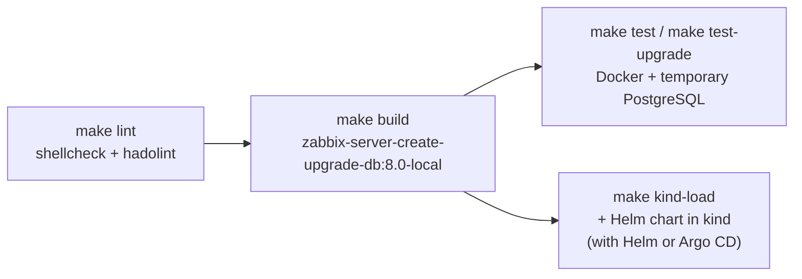

<!-- TOC -->

- [Local tests](#local-tests)
- [Lint](#lint)
- [Build](#build)
- [Tests with Docker](#tests-with-docker)
  - [Upgrade between Zabbix major versions](#upgrade-between-zabbix-major-versions)
- [Tests in Kubernetes with the Helm chart](#tests-in-kubernetes-with-the-helm-chart)

<!-- TOC -->

# Local tests

Install the [requirements](requirements.md). Run the commands in the root directory of this repository. Run ``make help`` to list all targets.



# Lint

```bash
make lint
```

# Build

Build the image for the local architecture. ``MAJOR_VERSION`` selects the Zabbix major version (default: ``8.0``):

```bash
make build
make build MAJOR_VERSION=7.4
```

The tag is ``zabbix-server-create-upgrade-db:<MAJOR_VERSION>-local``. Change it with ``IMAGE_TAG``. To build from another base image, e.g. a pre-release, set ``BASE_IMAGE``:

```bash
make build MAJOR_VERSION=8.0 BASE_IMAGE=zabbix/zabbix-server-pgsql:alpine-8.0.0 IMAGE_TAG=test
```

# Tests with Docker

The [tests/docker-test.sh](../tests/docker-test.sh) script runs the job like the Helm chart does, against a temporary PostgreSQL container, without Kubernetes:

```bash
make test
make test MAJOR_VERSION=7.4
make test TEST_SCENARIOS="fresh-install standalone-timeout"
```

| Scenario | What is tested |
|---|---|
| ``fresh-install`` | Creates the schema in an empty database, with the version of the image |
| ``rerun`` | A second run finds the schema up to date |
| ``standalone-aged`` | Waits until a standalone Zabbix Server, seen recently in the ``ha_node`` table, is older than the failover delay |
| ``standalone-timeout`` | Fails after ``JOB_WAIT_TIMEOUT`` while a standalone Zabbix Server keeps updating the ``ha_node`` table, instead of waiting forever |
| ``auto-without-kubernetes`` | With ``HELM_HOOK_TYPE=auto`` and no Kubernetes API, fails with a clear message |
| ``upgrade`` | Upgrades a schema created by an older major version (only run by ``make test-upgrade``) |

## Upgrade between Zabbix major versions

Creates the schema with the published image of an older major version (``UPGRADE_FROM_IMAGE``, default: Zabbix 7.4) and upgrades it with the local image:

```bash
make test-upgrade
make test-upgrade UPGRADE_FROM_IMAGE=ghcr.io/zabbix-community/zabbix-server-create-upgrade-db:7.0-20261009150714
```

# Tests in Kubernetes with the Helm chart

The behavior that depends on Kubernetes (detecting the installation or upgrade, scaling the Zabbix Server deployment down, the permissions of the job) is tested with the [Zabbix Helm chart](https://github.com/zabbix-community/helm-zabbix) in a kind cluster:

```bash
# In the clone of this repository
make build

# In the charts/zabbix directory of the clone of helm-zabbix
make kind-create
make kind-load IMAGES="zabbix-server-create-upgrade-db:8.0-local"
make external-db-create
helm upgrade --install zabbix . -n monitoring --wait \
  -f docs/example/kind/values-ha.yaml -f docs/example/ha/values-local-images.yaml
```

Or run ``make kind-load`` in this repository, which loads the image into the kind cluster ``KIND_CLUSTER_NAME`` (default: ``helm-zabbix``, the cluster of the chart).

The ``values-local-images.yaml`` file of the chart also uses the local image of the HA labels sidecar. Build it in the clone of [helm-zabbix-image-ha-labels-sidecar](https://github.com/zabbix-community/helm-zabbix-image-ha-labels-sidecar) or remove the ``haLabelsSidecar`` part of the file.

See the [HA tutorial of the chart](https://github.com/zabbix-community/helm-zabbix/blob/main/charts/zabbix/docs/example/ha/README.md) for the test scenarios (fresh installation, failover, transition from a standalone Zabbix Server to HA, upgrade between major versions), with Helm and with Argo CD.
